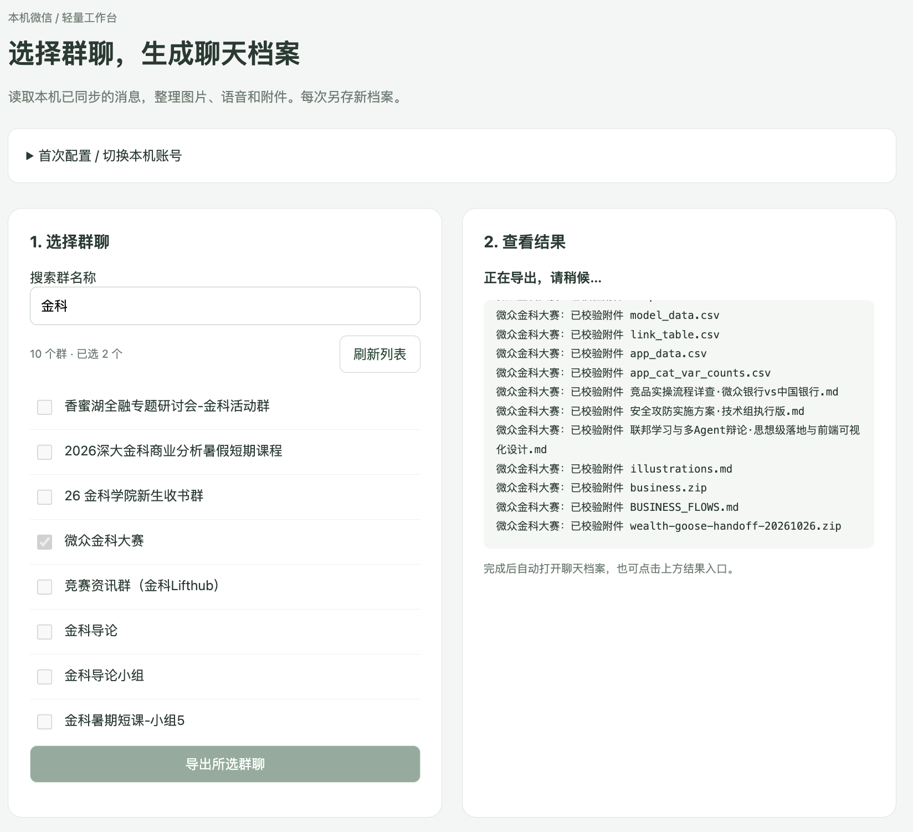
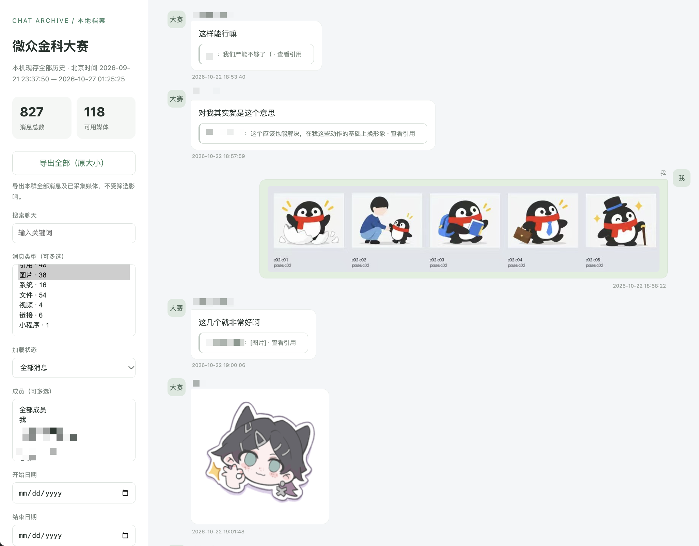

# WCE:微信全导|WeChat Chat Export

导出你想导出的任意聊天记录。包括文字、语音、图片、视频、GIF表情、各种类型文件、转发聊天记录。

## 软件截图

## 让你的 Agent 来装

把仓库链接发给编程 Agent，附上这句话：

> 帮我安装这个项目的 Mac 版。先读 `docs/INSTALL.md`，检查环境，再安装并打开。不要上传我的聊天或密钥。

需要 **M 系列 Mac，macOS 13+**。目前是 Mac 测试版，不同微信版本不一定都能用。

第一次读取前，需要你确认系统权限，并导入自己的数据库密钥。程序不会自动获取密钥；缺失的媒体也不一定能找回。

[安装说明](docs/INSTALL.md) · [使用说明](docs/USAGE.md) · [使用许可](LICENSE) · [第三方声明](THIRD_PARTY_NOTICES.md)

仅限个人非商业使用，允许自己修改。第三方代码按各自许可使用。
