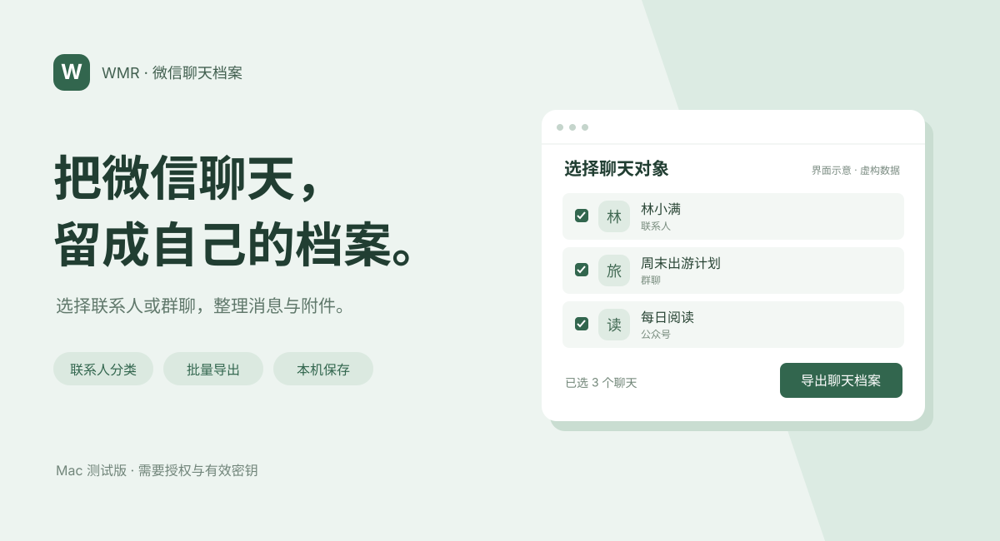

# WCE · 微信全导｜WeChat Export

[项目展示](https://julianchen-ai.github.io/WCE/) · [下载源码](https://github.com/JulianChen-AI/WCE/archive/refs/heads/main.zip) · [安装说明](docs/INSTALL.md)



**把微信聊天，留成自己的档案。**

选择联系人或群聊，把本机已同步的消息、图片、语音及附件整理成可浏览、可检索的聊天档案。数据在本机读取和保存，本工具不主动上传聊天内容。

## 可以做什么

- **选对聊天对象**：区分联系人、群聊、公众号、服务号与其他账号；显示可用头像，按最近会话排序。
- **批量导出**：一次选择多个联系人或群聊，各自生成档案。
- **浏览和检索**：按成员、日期、消息类型筛选，查看引用与合并转发。
- **保留媒体**：整理本机可获取的图片、语音、视频、表情及文件；缺失或未同步内容不保证恢复。
- **可选语音转写**：在本机转成文字，首次使用需要联网下载模型，结果可能有误。

## 让 Agent 帮你安装与连接

把仓库链接和下面这段话发给能操作本机的编程 Agent：

```text
请安装并连接 WCE：https://github.com/JulianChen-AI/WCE
优先复用本机已有项目。先阅读 docs/INSTALL.md 与 docs/USAGE.md，
先问我是否需要 App 和桌面双击入口，再按标准连接流程检查环境、权限和本人已有密钥。
不要只安装后就结束；实际验证联系人与会话可读取才算连接成功。
没有可用密钥时明确说明阻碍，不无限试工具，不上传聊天或密钥，不自动导出。
最后告诉我下次怎么启动。
```

也可以先[下载源码](https://github.com/JulianChen-AI/WCE/archive/refs/heads/main.zip)，按[安装说明](docs/INSTALL.md)操作。源码压缩包不是已经签名、公证的 App 安装包。

## 怎么使用

1. **连接微信**：登录本机微信，完成系统授权和有效密钥验证。未连接时，复制页面里的详细提示词，让 Agent 继续协助。
2. **选择聊天**：切换联系人、群聊或账号分类，搜索并勾选想保留的对象。
3. **导出档案**：生成后在本机浏览、筛选和检索。未经选择，不自动导出聊天。

下次启动可双击已创建的桌面入口，或打开实际安装的 App。浏览器端口可能变化，请使用启动入口而不是收藏临时网址。

## 环境与限制

- 当前为 **M 系列 Mac 测试版**，要求 macOS 13+、Python 3.11；可由 Agent 检查与安装。
- 文档目标微信版本为 **4.1.13**。其他版本需要实测，不保证兼容；暂不宣称支持 Windows 或 Intel Mac。
- 读取需要用户本人确认系统权限，以及本人的有效数据库密钥。**公开项目没有通用自动密钥获取器，不是下载后就能自动连接。**
- 只整理本机现存且可读取的历史；不保证恢复已删除消息或缺失媒体。
- 本页封面为虚构界面示意，不是实际账号截图；不代表所有媒体类型均已在所有环境验证。

## 本机运行结构

```text
本机浏览器：连接 → 选择聊天 → 查看导出结果
    ↓
Python 本地服务：验证配置、读取数据库、调度导出
    ↓
本机聊天档案：消息、媒体与检索页面
```

展示页只是静态介绍，不连接微信、不读取数据库，也不接收上传。实际工具运行于你的电脑。

## 隐私与许可

只处理本人有权处理的数据。不要把数据库、密钥或导出档案提交到仓库或公开分享；使用外部 Agent 时，也不要把聊天原文与密钥发进对话。本机处理不等于任何情况下“绝不泄漏”。

原创部分采用[个人非商业使用许可](LICENSE)，不是 MIT；第三方部分遵循各自许可，见[第三方声明](THIRD_PARTY_NOTICES.md)。
